# Erase Discord Messages

Delete your older Discord messages while keeping recent conversations intact. Use one chat or a saved queue of DMs, groups, and servers.

**[Install Erase](https://raw.githubusercontent.com/saintordevil/erase-discord-messages/main/Erase.user.js)** · **[Latest release](https://github.com/saintordevil/erase-discord-messages/releases/latest)** · **[Changelog](CHANGELOG.md)**

## Start here

1. Install [Tampermonkey](https://www.tampermonkey.net/) in desktop Chrome, then **[add Erase](https://raw.githubusercontent.com/saintordevil/erase-discord-messages/main/Erase.user.js)**. Enable [userscript permission](https://www.tampermonkey.net/faq.php#Q209) if prompted. Update the existing entry when upgrading to keep your saved data.
2. Open Discord and click the header's trash icon or press **Ctrl+D**. Choose your scope and newest-message protection.
3. Deletion is permanent, so preview first: **Filter > Dry run** for one chat, or **Preview queue** for several. Review the results, then disable Dry run or choose **Start queue** to delete.

**Keep newest messages** defaults to **30**, counting everyone's messages separately in each channel. Erase deletes only your eligible older messages; new arrivals stay protected. Chats with 30 or fewer messages are skipped. Set **0** to turn protection off.

## Features & previews

<table align="center" width="100%">
<tr><th width="50%">Follow your current chat</th><th width="50%">Queue DMs, groups &amp; servers</th></tr>
<tr><td width="50%" valign="top" align="center"><a href="assets/follow-chat-closeup.gif">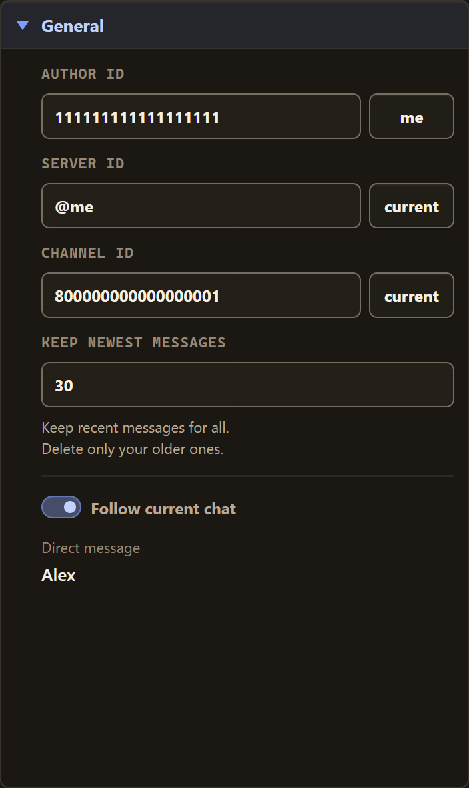</a></td><td width="50%" valign="top" align="center"><a href="assets/queue-closeup.gif">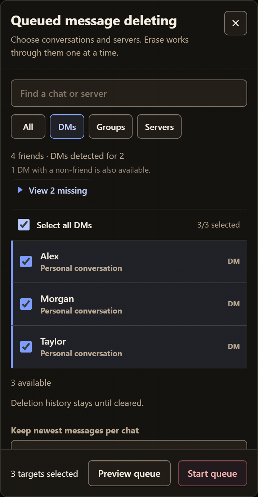</a></td></tr>
<tr><td width="50%" valign="top"><strong>Follow current chat</strong> fills your scope automatically. Turn it off for manual selection; changing chats never redirects an active run.</td><td width="50%" valign="top"><strong>Select all</strong> follows the current category and search. <strong>All</strong> and <strong>DMs</strong> also show missing friends: select them to add existing DMs without reopening each chat. Open chats with non-friends remain available.</td></tr>
</table>

<table align="center" width="100%">
<tr><th width="50%">Keep your place</th><th width="50%">Refine and control a run</th></tr>
<tr><td width="50%" valign="top"><strong>Restore saved queue &gt; Resume queue</strong> keeps the original selection, filters, and protection after an interruption. Completed targets are skipped; the unfinished target is rechecked. Nothing resumes automatically.</td><td width="50%" valign="top"><strong>Filter</strong>, <strong>Messages interval</strong>, and <strong>Date interval</strong> narrow by text, regex, links, files, pinned messages, IDs, or dates. Queue protection and the optional <strong>Only delete before</strong> date apply to every target.</td></tr>
<tr><td width="50%" valign="top"><strong>Recently deleted</strong> remembers confirmed activity for chats and missing friends, including closed DMs, until you choose <strong>Clear history</strong>. A recheck with nothing left to delete keeps the badge. Clearing history preserves your queue.</td><td width="50%" valign="top"><strong>Pause / Stop</strong>, <strong>Auto-scroll</strong>, <strong>Streamer mode</strong>, and <strong>Diagnostics</strong> help manage the run. Hover toggles for explanations; resize the panel without overlapping progress text.</td></tr>
</table>

<table align="center" width="100%">
<tr><th width="50%">Webhook setup</th><th width="50%">End-of-run report</th></tr>
<tr><td width="50%" valign="top" align="center"><a href="assets/webhook-setup-readable.gif">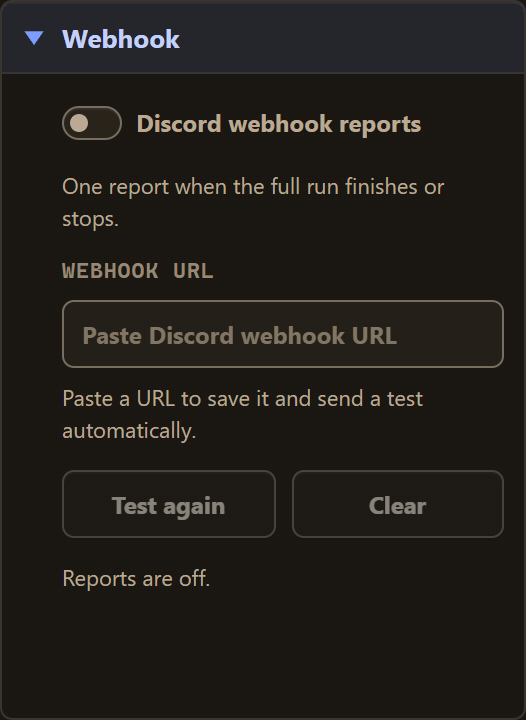</a></td><td width="50%" valign="top" align="center"><a href="assets/webhook-report-readable.png">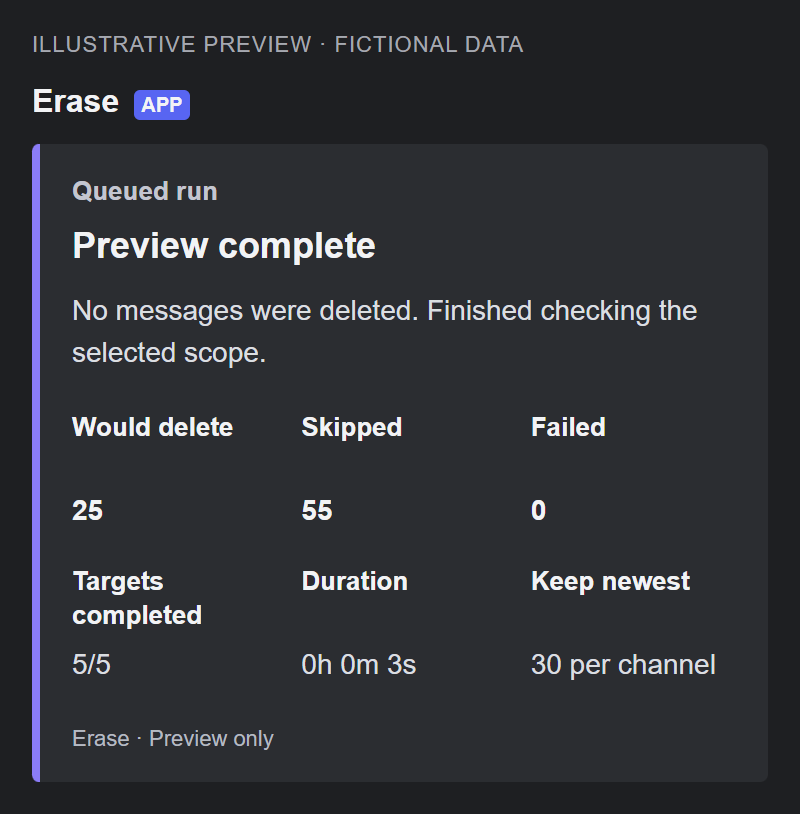</a></td></tr>
<tr><td width="50%" valign="top">Paste a URL in <strong>Webhook</strong> to save it and send one labelled test. <strong>Test delivered</strong> or <strong>Webhook error</strong> confirms the result. Testing works with reports off; use <strong>Test again</strong> to retry. Editing cancels outdated checks, and reloads do not resend tests.</td><td width="50%" valign="top">Enable <strong>Discord webhook reports</strong> for one clean summary card: blue for completion, purple for previews, and distinct issue, stop, or failure states. See totals, progress, duration, and protection without message contents or account credentials. <strong>Clear</strong> removes the saved URL.</td></tr>
</table>

<strong>Settings and queue screenshots</strong>

Click any image to view it at full size.

<table align="center" width="100%">
<tr><th width="50%">General</th><th width="50%">Filter</th></tr>
<tr><td width="50%" valign="top" align="center"><a href="assets/general-controls.png">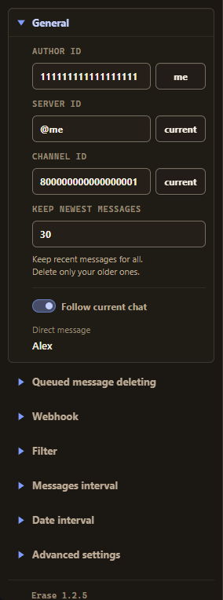</a></td><td width="50%" valign="top" align="center"><a href="assets/filter.png">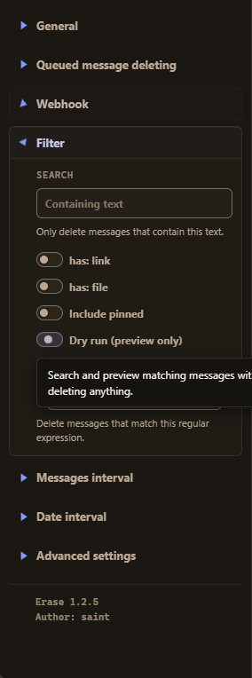</a></td></tr>
</table>

<table align="center" width="100%">
<tr><th width="50%">Missing friends &amp; history</th><th width="50%">Restore a saved queue</th></tr>
<tr><td width="50%" valign="top" align="center"><a href="assets/missing-friend-history.png">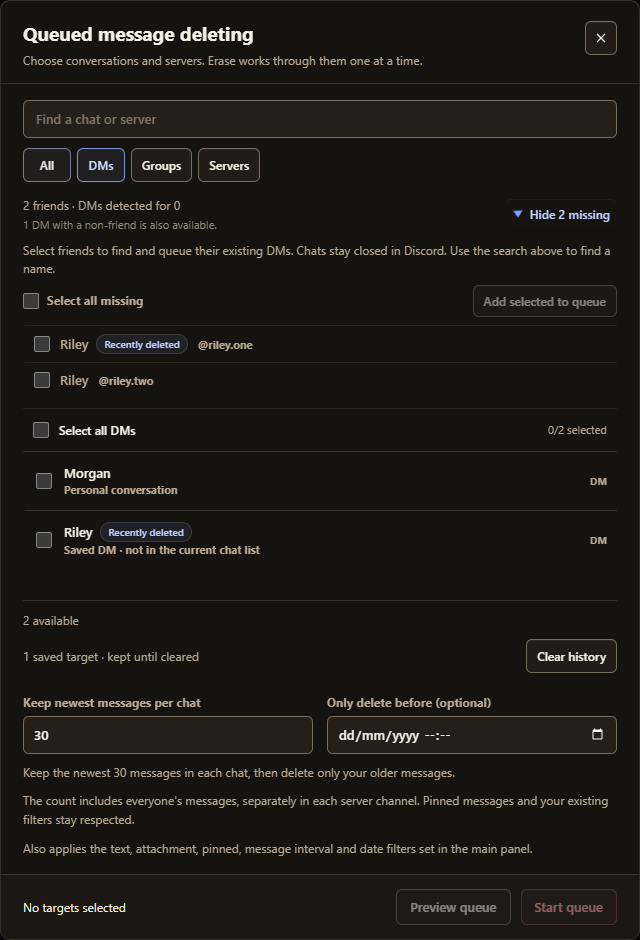</a></td><td width="50%" valign="top" align="center"><a href="assets/restored-queue.png">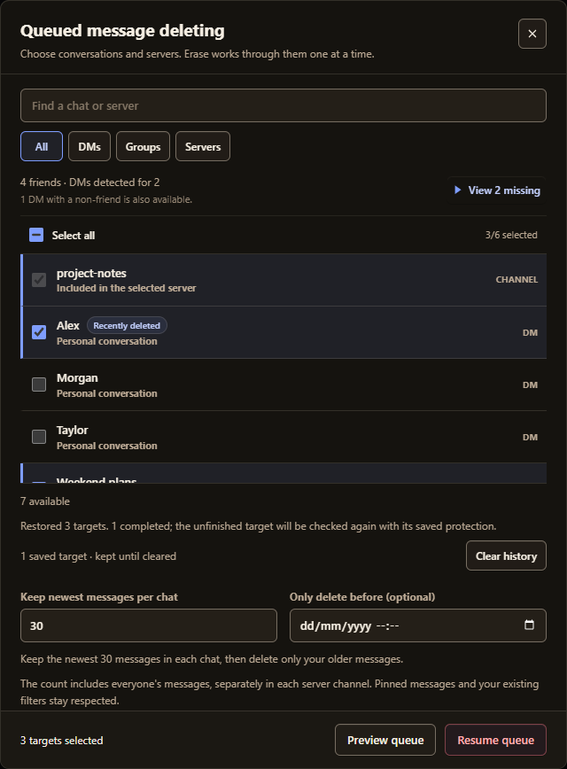</a></td></tr>
</table>

<table align="center" width="100%">
<tr><th width="50%">Message interval</th><th width="50%">Date interval</th></tr>
<tr><td width="50%" valign="top" align="center"><a href="assets/message-interval.png">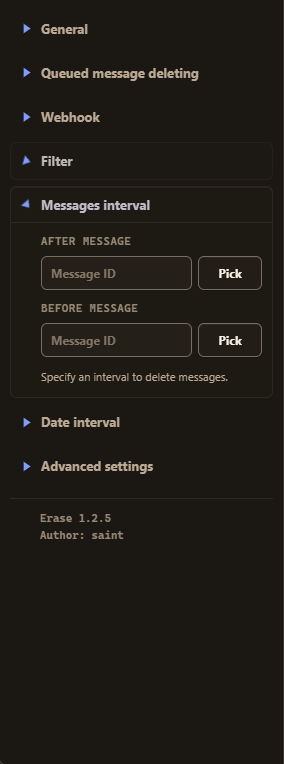</a></td><td width="50%" valign="top" align="center"><a href="assets/date-interval.png">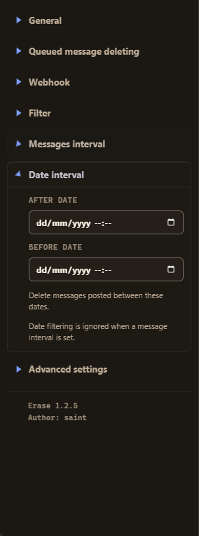</a></td></tr>
</table>

<table align="center" width="100%">
<tr><th width="50%">Webhook</th><th width="50%">Advanced settings</th></tr>
<tr><td width="50%" valign="top" align="center"><a href="assets/webhook.png">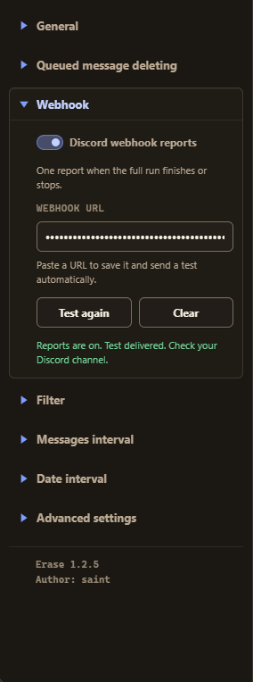</a></td><td width="50%" valign="top" align="center"><a href="assets/advanced.png">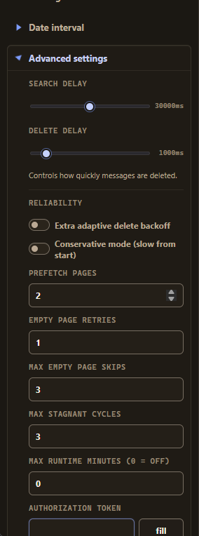</a></td></tr>
</table>

<strong>Privacy and limits</strong>

- Automating a normal Discord account can violate Discord's rules and risk account action. Use only where authorized.
- No bundled login, telemetry, or developer server. Settings, queues, and history stay in local, account-scoped userscript-manager storage. Clearing manager data removes them; browser storage limits still apply. Older records already discarded by previous versions cannot be recovered.
- A badge confirms deletion activity, not an empty chat. Protected or filtered messages may remain. A chat with fewer than 30 of *your* messages is not necessarily short enough to skip. Closed DMs are never selected automatically.
- Results depend on Discord access, indexing, and rate limits. Age-restricted channels are detected automatically. Keep Discord open: background throttling, sleep, and browser suspension can interrupt work, and sudden power loss may lose the latest checkpoint.
- Message-ID boundaries take precedence over date boundaries on the same side. Streamer mode hides fields in Erase, not the rest of Discord. Advanced settings adjust pacing and bounded retries.

Previews use fictional chats. The webhook example shows a preview run, which does not delete messages.

An updated [Undiscord](https://github.com/victornpb/undiscord) fork by **Saint ([saintordevil](https://github.com/saintordevil))**, crediting **Victor (Victornpb) and contributors** for the original design and implementation. Free to use, modify, and redistribute under [LICENSE](LICENSE), the inherited MIT-labelled terms with an additional attribution requirement. Not affiliated with Discord.
